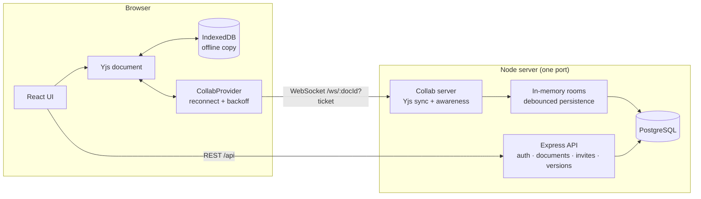

# CollabNotes

[](https://github.com/YOUR_USERNAME/collab-notes/actions/workflows/ci.yml)


Real-time collaborative **notes**, **whiteboards** and **task boards**. Multiple people edit the same
document at the same time, see each other's cursors, and never lose changes — even when offline.

> **Live demo:** _add your URL here_ &nbsp;·&nbsp; **Demo GIF:** _add a short screen recording of two windows editing together_

Built with React + TypeScript, Express, **PostgreSQL**, WebSockets and [Yjs](https://yjs.dev) (CRDTs).

## Features

| Area | What you get |
| --- | --- |
| **Notes** | Rich text (headings, lists, quotes, code) via TipTap v3 / ProseMirror, live remote cursors with names, per-user undo/redo, HTML export |
| **Whiteboard** | Pen + eraser, colors, brush sizes, undo/redo, live strokes from other users, touch/pen support, high-DPI canvas, PNG export |
| **Task board** | Drag-and-drop between and within columns, inline edit, priority, due dates, JSON export. Concurrent moves never duplicate a card |
| **Sharing** | Invite links with **editor / viewer** roles, optional **single-use** links, owners can **list and revoke** links, member management, access revoked live (kicks connected users) |
| **Version history** | Save named versions, restore any version for everyone (the current state is saved first, so a restore is undoable). The newest 50 versions per document are kept; older ones are pruned automatically |
| **Offline** | Edits are kept in IndexedDB and merged when the connection returns; automatic reconnect with exponential backoff |
| **Security** | bcrypt password hashing, zod validation, rate limiting, helmet + CSP, short-lived WebSocket tickets, origin checks, role enforcement on the socket |
| **UX** | Dark/light theme, dashboard search, rename/delete, responsive layout, accessible controls |

## Architecture



**Why Yjs?** Documents are CRDTs, so concurrent edits merge deterministically without a central lock
or operational-transform server. The server is a relay and persistence layer; clients converge on
their own.

### How a connection is secured

1. The client calls `POST /api/documents/:id/ws-ticket` with its JWT. The server checks membership.
2. It receives a **60-second ticket bound to that user and document** (the real JWT never appears in a URL).
3. The WebSocket upgrade verifies the ticket, the `Origin`, and re-reads the user's **role from the database**.
4. `viewer` connections can read but their document updates are dropped server-side.

### Persistence

Rooms live in memory while someone is connected. Changes mark the room dirty and are written to PostgreSQL
(`BYTEA` column) at most once every 2 s (debounced), and immediately when the last client leaves or the
server receives `SIGTERM`. Saves for a room are serialised, so an older snapshot can never overwrite a newer
one, and concurrent joins of the same document share a single room. Only the *incremental* Yjs update is
broadcast to other clients.

### Database

- Schema is managed by **versioned migrations** (`server/src/db.ts`), applied automatically at startup inside a
  transaction and guarded by a PostgreSQL advisory lock, so several instances can boot at once safely.
- The `UNIQUE` / foreign-key / `CHECK` constraints are the source of truth (e.g. two simultaneous sign-ups with the
  same email cannot both succeed; deleting a document cascades to members, invites and versions).
- Add a schema change by appending a new entry to `MIGRATIONS` — never edit one that has shipped.

## Getting started

Requirements: Node.js ≥ 20 and PostgreSQL ≥ 13 (Docker is the easiest way to get one).

```bash
git clone https://github.com/YOUR_USERNAME/collab-notes.git
cd collab-notes
docker compose up -d db          # PostgreSQL on localhost:5432 (also creates a separate test database)
cp .env.example server/.env      # defaults already point at that database
npm install                      # root tooling (concurrently)
npm run install:all              # server + client dependencies
npm run dev                      # API on :3001 (runs migrations), client on http://localhost:5173
```

No Docker? Install PostgreSQL yourself, create a database named `collab_notes`, and set `DATABASE_URL` in `server/.env`.

Open the app in **two different browsers** (or one normal + one private window), register two users,
and share a document with an invite link.

### Useful scripts

| Command | What it does |
| --- | --- |
| `npm run dev` | Server (watch mode) + Vite dev server |
| `npm test` | Server and client test suites |
| `npm run typecheck` | `tsc --noEmit` for both packages |
| `npm run build` | Production builds of client and server |
| `npm start` | Run the built server and serve the built client on one port |

## Configuration

All settings are environment variables, validated at startup (see [`.env.example`](.env.example)).

| Variable | Default | Notes |
| --- | --- | --- |
| `DATABASE_URL` | local Postgres | PostgreSQL connection string. **Required** in production. Managed hosts usually need `?sslmode=require` |
| `JWT_SECRET` | dev-only fallback | **Required** (≥16 chars) when `NODE_ENV=production`; the server refuses to start without it |
| `DB_SCHEMA` | `public` | Optional PostgreSQL schema (the tests use a throw-away one per file) |
| `DB_POOL_MAX` | `10` | Max connections in the pool |
| `PORT` | `3001` | HTTP **and** WebSocket share this port |
| `STATIC_DIR` | – | Serve the built client from the server (single-container deploy) |
| `CORS_ORIGINS` | – | Extra allowed origins (comma-separated). Not needed when same-origin |
| `TRUST_PROXY` | `0` | Set to `1` behind one reverse proxy so rate limiting sees real client IPs |
| `BCRYPT_ROUNDS` | `10` | 4–15 |

## Deploying

See **[docs/DEPLOYMENT.md](docs/DEPLOYMENT.md)** for Neon/Supabase + Render/Fly.io/Railway walkthroughs.
The app container is **stateless** (all data is in PostgreSQL), so it needs no persistent disk.
Quick start with Docker (app + database):

```bash
JWT_SECRET=$(openssl rand -base64 48) docker compose up --build
# → http://localhost:3001
```

## API overview

All routes except `/api/auth/register`, `/api/auth/login`, `/healthz` (liveness) and `/readyz` (readiness, checks the database) require `Authorization: Bearer <jwt>`.

| Method & path | Role | Purpose |
| --- | --- | --- |
| `POST /api/auth/register` · `POST /api/auth/login` · `GET /api/auth/me` | – | Account + session |
| `GET /api/documents` · `POST /api/documents` | member | List / create |
| `GET/PATCH/DELETE /api/documents/:id` | viewer / editor / owner | Read / rename / delete |
| `POST /api/documents/:id/ws-ticket` | viewer | Short-lived WebSocket ticket |
| `GET /api/documents/:id/members` · `PATCH/DELETE …/members/:userId` | member / owner | Manage access (members may remove themselves) |
| `POST /api/documents/:id/invites` | owner | Create an invite link (7-day expiry; body `{ role, singleUse? }`; max 25 live links per document) |
| `GET /api/documents/:id/invites` · `DELETE …/invites/:inviteId` | owner | List live links (tokens are stored hashed, so they cannot be re-shown) / revoke one |
| `GET /api/invites/:token` · `POST /api/invites/:token/accept` | any user | Preview / join |
| `GET/POST /api/documents/:id/versions` · `POST …/versions/:vid/restore` | viewer / editor | Version history |
| `WS /ws/:documentId?ticket=…` | viewer+ | Yjs sync + presence |

## Testing

- **Server (44 tests, Vitest + Supertest, against a real PostgreSQL):** auth and validation, role matrix, invite
  semantics, expiry, revoke, single-use (including a race for one link) and the per-document cap, awareness-spoofing rejection, version pruning, **real WebSocket sync between two clients**, viewer write-blocking, ticket/origin rejection,
  malformed-frame resilience, live access revocation, version save/restore, concurrent sign-ups, concurrent
  migrations, concurrent room loading, reload-from-database, cascading deletes. Each test file runs in its own
  schema, so nothing is left behind. Needs `docker compose up -d db` (or `TEST_DATABASE_URL`).
- **Client (32 tests, Vitest + Testing Library):** provider reconnect behaviour (including a regression test
  for duplicate update sending), backoff, fatal-error handling, CRDT task-move convergence, whiteboard geometry,
  date helpers, the login flow, the share dialog (list / revoke / single-use), and the notes editor (renders shared content, uses the `content` field the server restores into, read-only for viewers).

## Project structure

```
server/src
  config.ts  db.ts  auth.ts  documents.ts  http.ts  app.ts  index.ts
  routes/    auth · documents · invites
  collab/    rooms.ts (lifecycle, persistence, restore) · protocol.ts (Yjs messages) · server.ts (upgrade + auth)
client/src
  lib/       api · collabProvider · tasks · whiteboardGeometry · format · colors
  hooks/     useAuth · useCollab · useTheme
  components/ NotesEditor · Whiteboard · TaskBoard · ShareDialog · VersionHistory · …
  pages/     Login · Dashboard · Document · Invite
```

## Known limitations / roadmap

- **One app instance for collaboration.** Live rooms are held in memory, so running several app instances needs
  sticky routing per document or a pub/sub layer (e.g. Redis) to relay updates between them. The database itself
  is not the bottleneck: PostgreSQL scales independently.
- Persistence stores a full snapshot per save. Fine for notes-sized documents; very large boards would benefit from
  incremental updates + periodic compaction.
- No email verification or password reset yet; the JWT is kept in `localStorage` (mitigated by a strict CSP).
- Search is by title only (not full-text).
- Playwright end-to-end tests with two browser contexts are the next test to add.

## License

[MIT](LICENSE)
